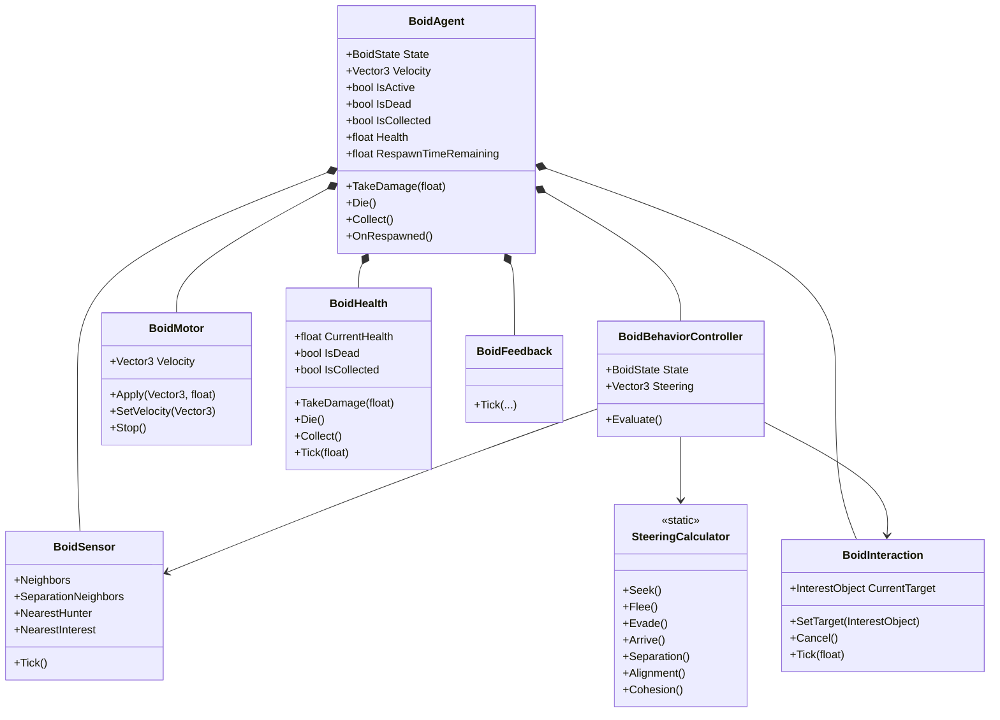
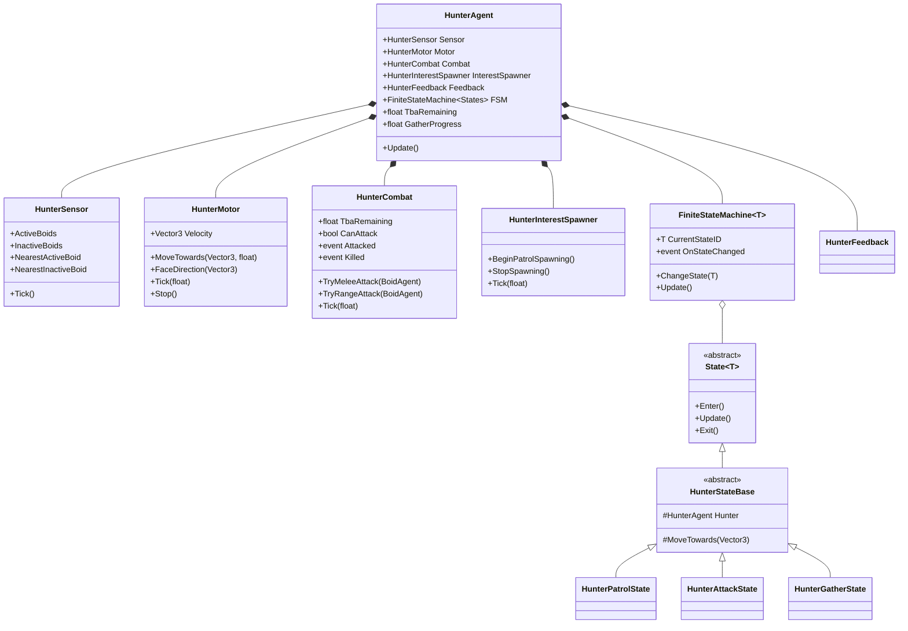
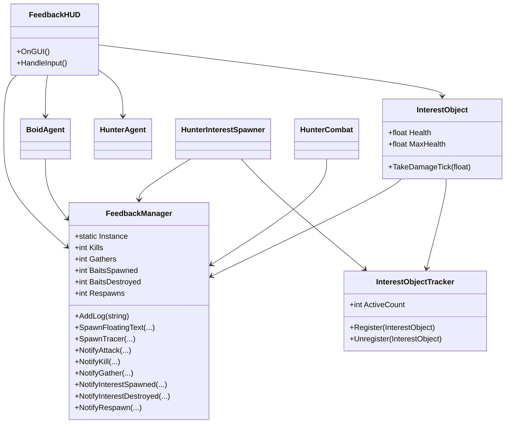
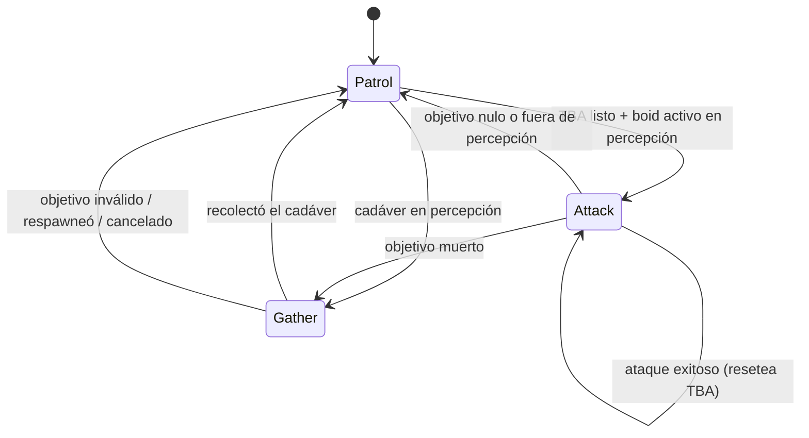
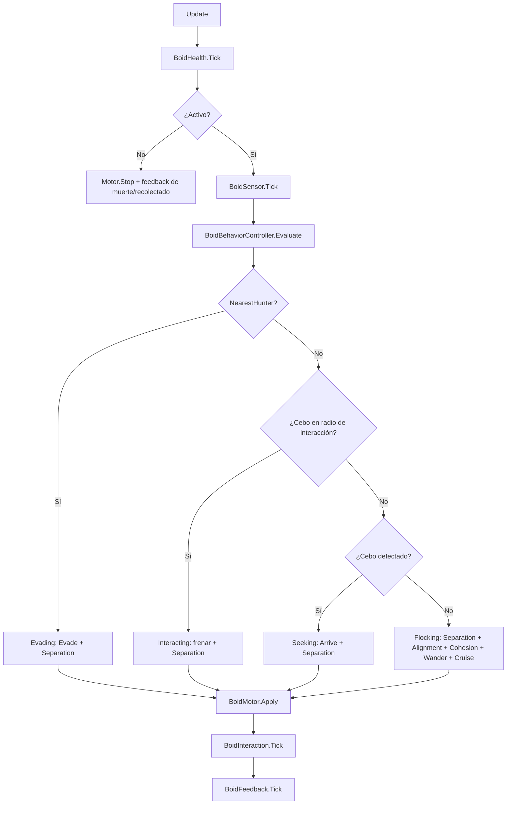
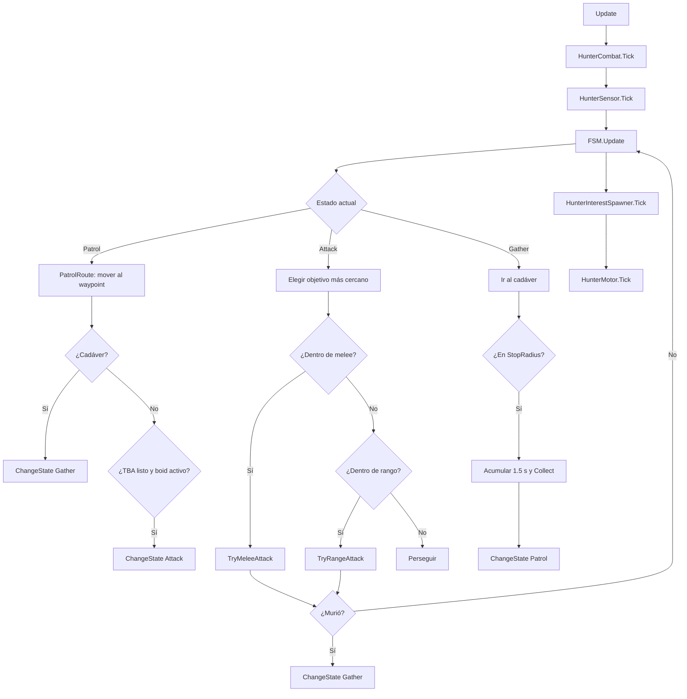

# Arquitectura

El proyecto separa **decisión**, **percepción**, **movimiento**, **vida** y **presentación**. Los `MonoBehaviour` son puntos de entrada delgados; la lógica vive en clases C# planas que se componen desde ellos.

## Diagrama de clases

## FSM del cazador

Reglas:

- `Attack` solo se alcanza desde `Patrol` y solo si `HunterCombat.CanAttack` es verdadero.
- Salir de `Attack` por perder visión **no** resetea el TBA.
- Un ataque exitoso **sí** resetea el TBA.
- Las transiciones se ejecutan únicamente dentro de los estados, llamando a `_fsm.ChangeState(...)`.

## Flujo por frame

### Boid

### Cazador

## Responsabilidades

| Clase | Responsabilidad | No hace |
|---|---|---|
| `BoidAgent` | Coordinar subsistemas y exponer estado | Steering, detección ni vida |
| `BoidSensor` | Percepción limitada y cacheada | Decidir comportamiento |
| `BoidBehaviorController` | Prioridad y combinación de fuerzas | Mover transforms |
| `BoidMotor` | Integración de velocidad, orientación y wrap | Decidir destino |
| `BoidHealth` | Vida, muerte, recolección y respawn | Renderizado |
| `BoidInteraction` | Daño por intervalo al cebo | Elegir objetivo |
| `SteeringCalculator` | Matemática pura de steering | Tocar escena o `Time` |
| `HunterAgent` | Configuración, referencias y `FSM.Update()` | Movimiento, ataques o transiciones |
| `HunterSensor` | Detección de boids vivos y cadáveres | Decidir estados |
| `HunterMotor` | Movimiento, orientación y velocidad | Combate |
| `HunterCombat` | TBA, daño y eventos | Elegir objetivo |
| `HunterInterestSpawner` | Spawn de cebos y límite máximo | Patrullar |
| `HunterStateBase` | Helpers comunes de movimiento | Lógica de un estado |
| `HunterPatrolState` | Waypoints, spawn de cebos y transiciones | Mover directamente el transform |
| `HunterAttackState` | Persecución, melee/rango y salida a Gather | Resetear TBA |
| `HunterGatherState` | Acercarse, esperar y recolectar | Detectar cadáveres |
| `FeedbackManager` | Contadores, log y textos flotantes | Dibujar GUI |
| `FeedbackHUD` | Único `OnGUI`, etiquetas, barras y leyenda | Lógica de simulación |
| `InterestObject` | Vida del cebo, color y destrucción | Spawn |
| `InterestObjectTracker` | Registro y conteo de cebos activos | Spawn |

## Decisiones de implementación

- **Clases planas en lugar de más `MonoBehaviour`:** evita agregar componentes al prefab y mantiene el wiring existente.
- **Namespace global:** reduce el riesgo de romper referencias de escena y GUIDs.
- **`MaterialPropertyBlock`:** cambia colores sin instanciar materiales ni romper batching.
- **Un solo `OnGUI`:** el HUD se centraliza en `FeedbackHUD`; las teclas se leen desde `Event.current` porque el proyecto usa el Input System nuevo.
- **Auto-bootstrap del feedback:** si la escena no tiene `FeedbackManager`, se crea al cargar para que el HUD nunca falte.
- **Detección periódica:** sensores con fase aleatoria e intervalo configurable para repartir el costo.
